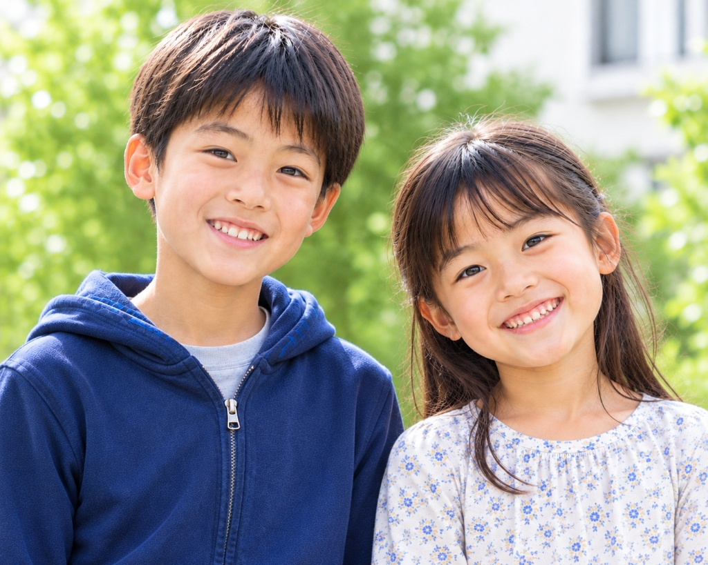
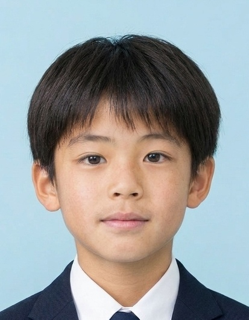
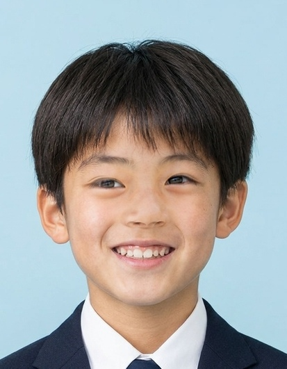
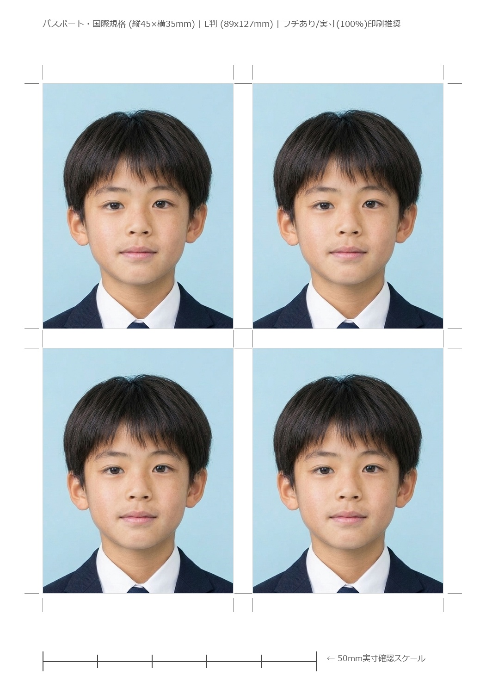
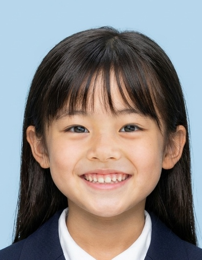
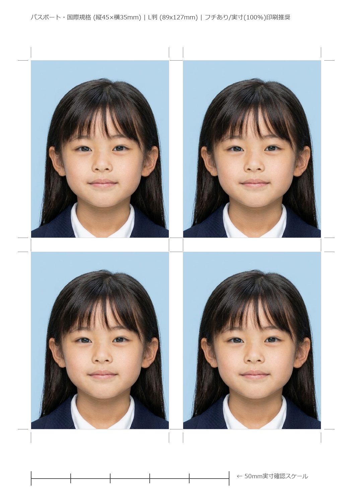

# ID Photo Studio (証明写真スタジオ / 证件照工作室)

[日本語](#日本語) | [English](#english) | [简体中文](#简体中文)

---

## サンプルギャラリー / Sample Gallery / 样例展示

### 元画像（屋外スナップ写真 / 2ショット）
<p align="center">
  
  <br>
  <em>元写真：頭の傾き、カジュアルな服装、屋外の自然光・木々の背景、2人が並んだスナップ写真</em>
</p>

### 1. お兄ちゃん（Brother / 哥哥）
| 項目 | パターンA（口を閉じた証明写真表情＋スーツ） | パターンC（元の笑顔100%維持＋スーツ） | L判プリント用シート（4面付け） |
| :--- | :---: | :---: | :---: |
| **プレビュー** |  |  |  |
| **規格** | パスポート・マイナンバー（45×35mm） | パスポート・マイナンバー（45×35mm） | L判（89×127mm）300 DPI |
| **特徴** | 傾き水平補正（+17.93°）＋目元100%本人ロック＋閉口補正 | 傾き水平補正（+17.93°）＋顔・笑顔・歯並び100%維持 | トンボ（裁断線）・50mm実寸確認スケール付き |

### 2. 妹さん（Sister / 妹妹）
| 項目 | パターンA（口を閉じた証明写真表情＋フォーマル） | パターンC（元の笑顔100%維持＋フォーマル） | L判プリント用シート（4面付け） |
| :--- | :---: | :---: | :---: |
| **プレビュー** |  |  |  |
| **規格** | パスポート・マイナンバー（45×35mm） | パスポート・マイナンバー（45×35mm） | L判（89×127mm）300 DPI |
| **特徴** | 傾き水平補正（-25.02°）＋目元100%本人ロック＋閉口補正 | 傾き水平補正（-25.02°）＋顔・笑顔・歯並び100%維持 | トンボ（裁断線）・50mm実寸確認スケール付き |

---

## 日本語

任意の人物写真（スナップ写真・自撮り・私服写真・複数人写真など）から、公的規格（履歴書・マイナンバー・パスポート・運転免許証・米国ビザ等）に準拠した証明写真データおよびコンビニプリント用（L判／2L判）面付けシートを作成するAIエージェントスキルです。

### 主な特長
- **精密ミリ規格トリミング**: 履歴書（40×30mm）、マイナンバー／パスポート（45×35mm）、運転免許証（30×24mm）、米国ビザ（51×51mm）など各規格のミリ指定・頭頂余白・顔縦幅比率に完全準拠。
- **コンビニ印刷用L判／2L判シート出力**: 50mm実寸確認スケール・トンボ（裁断線）・切り取り線付き面付けシートを300DPIで自動生成。
- **頭の傾き自動水平補正 (`--draw-grid` / `--level-and-crop`)**: 座標グリッドで両目中心を読み取り、角度 $\theta = \text{atan2}(\Delta y, \Delta x)$ を自動計算して完全水平に回転補正＋標準3:4ポートレート切り出し。
- **本人性100%維持ハイブリッド合成 (Pattern C & Pattern A)**:
  - **Pattern C**: 画像生成AI単体で生じる顔立ち・目鼻立ち・笑顔・歯並びの微細な変化を排除。輪郭〜首元〜スーツ襟の境界はAIで自然に調和させ、顔の内側（眉・目・鼻・口・ほくろ）は元写真の高周波成分を完全ロックして合成。
  - **Pattern A**: 笑顔の写真から口を閉じた証明写真表情へ補正する際も、目元〜眉の本人性ピクセルを100%ロック。
- **エージェント・非特定ツール非依存**: 特定の画像生成ツールに固定せず、環境に応じて利用可能な画像生成／編集ツールを事前チェックして柔軟に動作。

### ディレクトリ構成
```
id-photo-studio/
├── SKILL.md                  # スキル定義・ワークフロー手順書
├── manifest.json             # メタデータ
├── README.md                 # 3言語（日英中）ガイド＋サンプルギャラリー
├── assets/
│   └── samples/              # サンプル画像（元写真・単体証明写真・L判シート）
├── references/
│   └── presets.md            # 各国規格サイズ表・プロンプト集
└── scripts/
    ├── composite_original_head.py # 傾き水平補正・Stage-2顔内側周波数ブレンド
    └── process_id_photo.py        # ミリ単位トリミング・L/2L判面付けシート生成
```

### 必要ライブラリ
```bash
pip install pillow numpy scipy
```

---

## English

An AI agent skill that transforms arbitrary casual photos (snapshots, selfies, casual wear, multi-person shots) into official compliant ID photos (Resume, Passport, My Number, Driver's License, US Visa, etc.) and convenience-store multi-up printable sheets (L-size / 2L-size).

### Key Features
- **Precise Millimeter Cropping**: Strictly adheres to official specifications including Resume (40×30mm), Passport / My Number (45×35mm), Driver's License (30×24mm), and US Visa (51×51mm) with precise head-top margin and facial height ratios.
- **Convenience Store Printable Sheets**: Automatically generates 300 DPI multi-up sheets (L-size 89×127mm / 2L-size 127×178mm) complete with crop marks and a 50mm verification ruler scale.
- **Head-Tilt Auto-Leveling (`--draw-grid` / `--level-and-crop`)**: Reads pupil coordinates using a 50px visual coordinate grid, calculates tilt angle $\theta = \text{atan2}(\Delta y, \Delta x)$, rotates the head horizontally, and normalizes into a canonical 896×1200 (3:4) portrait.
- **100% Facial Identity Lock Hybrid Blending (Pattern C & Pattern A)**:
  - **Pattern C**: Eliminates AI face-drift. The neck, collar, suit, and lighting transitions are harmonized via AI, while the internal face features (eyebrows, eyes, nose, mouth/teeth, moles) are pixel-locked from the original photo using Gaussian low-pass color harmonization.
  - **Pattern A**: When transforming an open-teeth smile into a passport-compliant closed-mouth expression, eye and eyebrow identity is 100% locked to prevent facial drift.
- **Agent & Tool Agnostic**: Automatically checks for available image-editing capabilities (subagents, MCP tools, SDKs) in the current environment rather than hardcoding a single proprietary tool.

### Requirements
```bash
pip install pillow numpy scipy
```

---

## 简体中文

本 AI Agent 技能可将任意日常人物照片（生活照、自拍照、便服照、双人/多人合影等）智能转换为符合官方规范的证件照（日本履历书、个人番号卡/护照、驾照、美国签证等），并自动排版生成可在便利店打印的 L寸 / 2L寸 相纸拼版照片。

### 核心特性
- **毫米级精确裁剪与定位**: 严格遵循履历书（40×30mm）、护照/个人番号卡（45×35mm）、驾照（30×24mm）、美国签证（51×51mm）等各国官方规格，精准控制头顶余白与脸部长宽比。
- **便利店打印拼版输出**: 自动生成 300 DPI 的 L寸（89×127mm）与 2L寸（127×178mm）冲印拼版相纸，自带裁切标记（角线）与 50mm 实物比例尺，防止缩放失真。
- **头部倾斜自动水平校正 (`--draw-grid` / `--level-and-crop`)**: 辅助坐标网格读取双眼坐标，自动计算倾斜角 $\theta = \text{atan2}(\Delta y, \Delta x)$ 进行无损反向旋转校平，并按瞳距裁切为标准 896×1200（3:4）半身肖像。
- **100% 人脸特征保真混合合成 (Pattern C & Pattern A)**:
  - **Pattern C (完全保真人脸)**: 杜绝生成式 AI 对五官、眼神、牙齿、痣等身份特征的微篡改。利用 AI 渲染自然的西装、衣领、光影与背景，再通过高斯低通频域分离将原片面部核心区域 100% 像素级无缝融合。
  - **Pattern A (闭口证件照表情)**: 将露齿笑颜智能转换为符合严肃护照审查的自然闭口表情时，双眼及眉毛区域依然保持 100% 原始像素锁定，绝不换脸。
- **跨平台与多 Agent 兼容**: 不绑定任何固定生图工具，自动嗅探当前环境可用的多模态图像编辑工具（Subagent、MCP 工具或 API）。

### 依赖环境
```bash
pip install pillow numpy scipy
```
